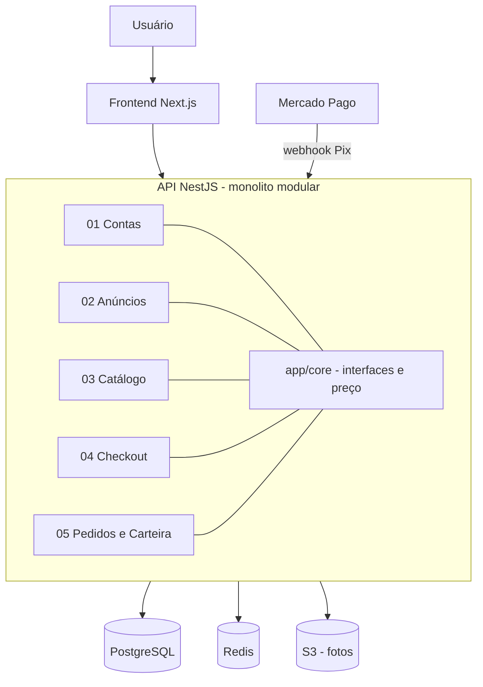
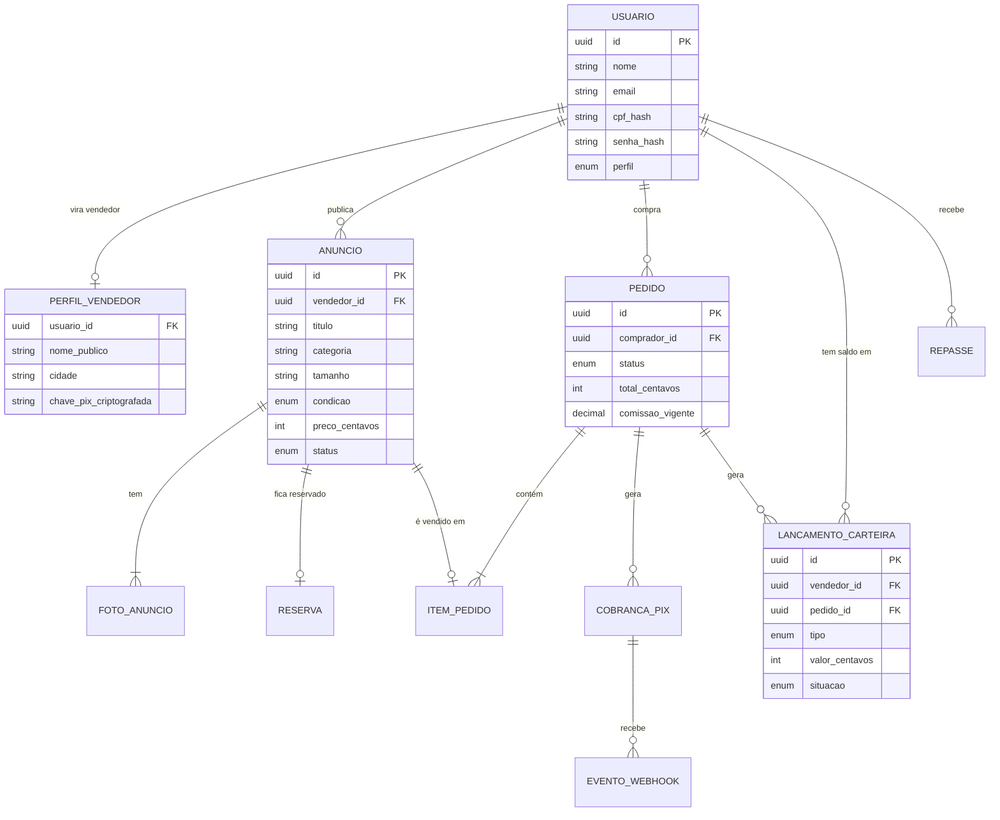

# Desa Pego

**Brechó online comunitário: qualquer pessoa anuncia as peças paradas no armário, vê quanto vai receber pela venda e o comprador paga com Pix.**

[Requisitos](REQUISITOS.md) · [Arquitetura](docs/ARQUITETURA.md) · [Issues](https://github.com/Mariaclara2424/Desa-Pego/issues) · [Quadro do projeto](https://github.com/users/Mariaclara2424/projects/2) · [Como contribuir](CONTRIBUTING.md)

---

> **Projeto em andamento.** O planejamento, a arquitetura e a esteira de CI já estão prontos; os módulos estão sendo desenvolvidos agora. Acompanhe o progresso pelas [issues](https://github.com/Mariaclara2424/Desa-Pego/issues) e pelo [quadro do projeto](https://github.com/users/Mariaclara2424/projects/2).

## Sobre o projeto

O Desa Pego conecta quem quer desapegar de roupas e calçados com quem procura moda acessível e circular. A plataforma cuida da parte chata de uma venda entre pessoas: reserva da peça, cobrança via Pix, divisão do valor e repasse ao vendedor.

- **Para quem vende:** cadastra a peça com fotos, usa o simulador para ver o valor líquido que vai receber e acompanha o saldo na carteira.
- **Para quem compra:** busca e filtra a vitrine, reserva a peça no checkout e paga com Pix.
- **Para quem administra:** define comissão, taxas e frete, registra os repasses e modera anúncios.

Uma mesma conta pode comprar e vender. Ela passa a vender ao cadastrar uma chave Pix.

Está sendo desenvolvido como projeto acadêmico do curso de Ciência da Computação do **CEUB**, por um grupo de cinco pessoas, com um fluxo de trabalho parecido com o de uma equipe de produto: requisitos com critérios de aceitação, issues, branches por requisito, Pull Requests com revisão obrigatória e CI.

## Status do projeto

| Etapa | Situação |
| --- | --- |
| Levantamento dos 15 requisitos do MVP com critérios de aceitação | Concluído |
| Documento de arquitetura com 8 decisões registradas (ADRs) | Concluído |
| Organização do repositório: issues, labels, quadro, templates e revisão em rodízio | Concluído |
| CI com lint, testes (PostgreSQL e Redis) e detecção de segredos | Concluído |
| Desenvolvimento dos 5 módulos (backend e frontend) | Em andamento |
| Testes de integração entre os módulos e homologação | A fazer |
| Deploy | A fazer |

## Como funciona uma venda

```mermaid
flowchart LR
    A[Vendedor anuncia a peça] --> B[Simulador mostra o valor líquido]
    B --> C[Peça aparece na vitrine]
    C --> D[Comprador inicia o checkout]
    D --> E[Peça fica reservada por 15 min]
    E --> F[Pagamento via Pix]
    F --> G[Webhook confirma o pagamento]
    G --> H[Vendedor envia a peça]
    H --> I[Comprador confirma o recebimento]
    I --> J[Saldo liberado na carteira]
```

## Funcionalidades do MVP

O MVP tem **15 requisitos** divididos em **5 módulos independentes**, um para cada integrante. Os módulos só conversam entre si pelas interfaces de `app/core`.

| Módulo | Requisitos | Responsável |
| --- | --- | --- |
| **01** · Contas e Perfil do Vendedor | [#1](../../issues/1) Cadastro e Login · [#2](../../issues/2) Perfil com Chave Pix · [#3](../../issues/3) Testes | Clarice Nunes |
| **02** · Anúncios e Simulador de Ganho | [#4](../../issues/4) Criar e Gerenciar Anúncio · [#5](../../issues/5) Simulador e Preço Sugerido · [#6](../../issues/6) Testes | Lívia Morais |
| **03** · Catálogo e Detalhes da Peça | [#7](../../issues/7) Vitrine com Busca e Filtros · [#8](../../issues/8) Detalhes da Peça · [#9](../../issues/9) Testes | Helena Furtado |
| **04** · Carrinho, Checkout e Pix | [#10](../../issues/10) Carrinho com Reserva · [#11](../../issues/11) Checkout com Pix · [#12](../../issues/12) Testes | Marina Almeida |
| **05** · Pedidos, Carteira e Administração | [#13](../../issues/13) Status do Pedido · [#14](../../issues/14) Carteira e Painel do Admin · [#15](../../issues/15) Testes | Maria Clara Pedrosa |

Alguns pontos que tornam o projeto interessante do ponto de vista técnico:

- **Peça única, sem venda duplicada:** a reserva usa atualização atômica no banco (`UPDATE ... WHERE status = 'disponivel'`) e expira sozinha por um job no Redis.
- **Webhook idempotente:** a confirmação do Pix tem assinatura validada e só muda o pedido uma vez, mesmo se o evento chegar repetido.
- **Carteira como livro-razão:** cada venda gera lançamentos imutáveis em centavos, e o saldo é a soma deles. Nada de saldo "editado à mão".
- **Mesmo cálculo no front e no back:** o simulador de ganho e o pedido usam a mesma função em `app/core/pricing`, então o valor que o vendedor vê é o valor que ele recebe.
- **Máquina de estados do pedido:** transições inválidas (ex.: marcar como entregue antes de pago) são rejeitadas no backend.

Os critérios de aceitação de cada requisito estão no [REQUISITOS.md](REQUISITOS.md).

## Tecnologias

| Camada | Tecnologia |
| --- | --- |
| Frontend | Next.js (React) com TypeScript, SSR/ISR |
| Backend | NestJS (Node.js 20) com TypeScript, monolito modular |
| Banco de dados | PostgreSQL com Prisma Migrate e busca full-text |
| Cache, reservas e filas | Redis + BullMQ |
| Fotos das peças | Amazon S3 (MinIO no ambiente local) |
| Pagamento | Pix via `PagamentoProvider` (Mercado Pago; `PixSimuladoProvider` em dev e testes) |
| Testes | Jest + Supertest |
| CI | GitHub Actions + gitleaks |
| Infraestrutura planejada | Docker, AWS ECS Fargate, Terraform, Cloudflare |

## Arquitetura

Monolito modular: uma única API, dividida em cinco módulos com fronteiras claras. Cada integrante é dona de um módulo e os testes mockam as interfaces de `app/core`, então ninguém fica travada esperando o código da outra.

As principais decisões, com o motivo de cada uma, estão registradas como ADRs no [Documento de Arquitetura](docs/ARQUITETURA.md#10-decisões-arquiteturais), por exemplo: monolito modular em vez de microsserviços, somente Pix no MVP, carteira como livro-razão e ECS Fargate em vez de Kubernetes.

## Modelo de dados

> Modelo inicial, baseado no documento de arquitetura. Ele será ajustado conforme os módulos forem implementados.

## Perfis de acesso

| Ação | Comprador | Vendedor | Admin |
| --- | :---: | :---: | :---: |
| Buscar peças, reservar e pagar com Pix | Sim | Sim | Não |
| Ver as próprias compras e confirmar recebimento | Sim | Sim | Não |
| Anunciar peças e usar o simulador de ganho | Não | Sim | Não |
| Ver carteira, extrato e vendas; marcar pedido como enviado | Não | Sim | Não |
| Definir comissão, taxa Pix, frete e tabela de preço sugerido | Não | Não | Sim |
| Registrar repasse ao vendedor e ocultar anúncios | Não | Não | Sim |

As permissões são validadas no backend, por perfil e por posse do recurso (ex.: só o vendedor do pedido marca o envio). O frontend apenas esconde opções.

## Segurança e LGPD

- Senhas com hash **Argon2id**, JWT de curta duração e refresh token em cookie httpOnly.
- CPF e chave Pix **criptografados por campo**; a chave Pix é exibida mascarada e o CPF nunca aparece no perfil público.
- Duplicidade de CPF verificada por hash, sem precisar descriptografar.
- Endereço do comprador visível apenas para o vendedor daquele pedido.
- Webhook do Pix com assinatura validada e idempotência pelo ID do evento.
- Rate limiting em cadastro, login, busca e checkout.
- Nenhum segredo no repositório: `.env` fora do Git (veja o [`.env.example`](.env.example)) e **gitleaks** rodando em toda a história do repositório na CI.

## Como rodar localmente

> Em breve. Assim que os módulos tiverem código, esta seção vai trazer o passo a passo com Docker Compose (PostgreSQL, Redis e MinIO sobem com um comando) e o Pix simulado para testar o fluxo de compra sem cobrança real.

## O que estou aprendendo

- Transformar uma ideia em requisitos com critérios de aceitação testáveis e dividir o trabalho de forma justa entre cinco pessoas.
- Registrar decisões de arquitetura (ADRs) explicando o porquê de cada escolha, e não só o quê.
- Tratar concorrência em um caso real: duas pessoas tentando comprar a mesma peça ao mesmo tempo.
- Modelar dinheiro com segurança: valores em centavos, livro-razão imutável e webhooks idempotentes.
- Montar uma esteira de CI com banco e cache como serviços e detecção automática de segredos.
- Organizar um repositório de equipe com issues, quadro, templates, CODEOWNERS e revisão obrigatória de PRs.

## Próximos passos

Depois da primeira entrega, a arquitetura já prevê o encaixe de:

- cartão de crédito e boleto (nova implementação de `PagamentoProvider`);
- repasse automático e frete calculado com rastreio;
- login com Google e 2FA no painel do admin;
- avaliações, disputas, favoritos e notificações por e-mail;
- contador de impacto ambiental, passaporte da peça e outras ideias de economia circular.

## Autoras

| | |
| --- | --- |
| **Clarice Nunes** | [@claricenunes](https://github.com/claricenunes) |
| **Lívia Morais** | [@livmoorais](https://github.com/livmoorais) |
| **Helena Furtado** | [@helenafurtadoo](https://github.com/helenafurtadoo) |
| **Marina Almeida** | [@Marinasz05](https://github.com/Marinasz05) |
| **Maria Clara Pedrosa** | [@Mariaclara2424](https://github.com/Mariaclara2424) |

Projeto acadêmico desenvolvido no curso de Ciência da Computação do **CEUB – Centro Universitário de Brasília**.
