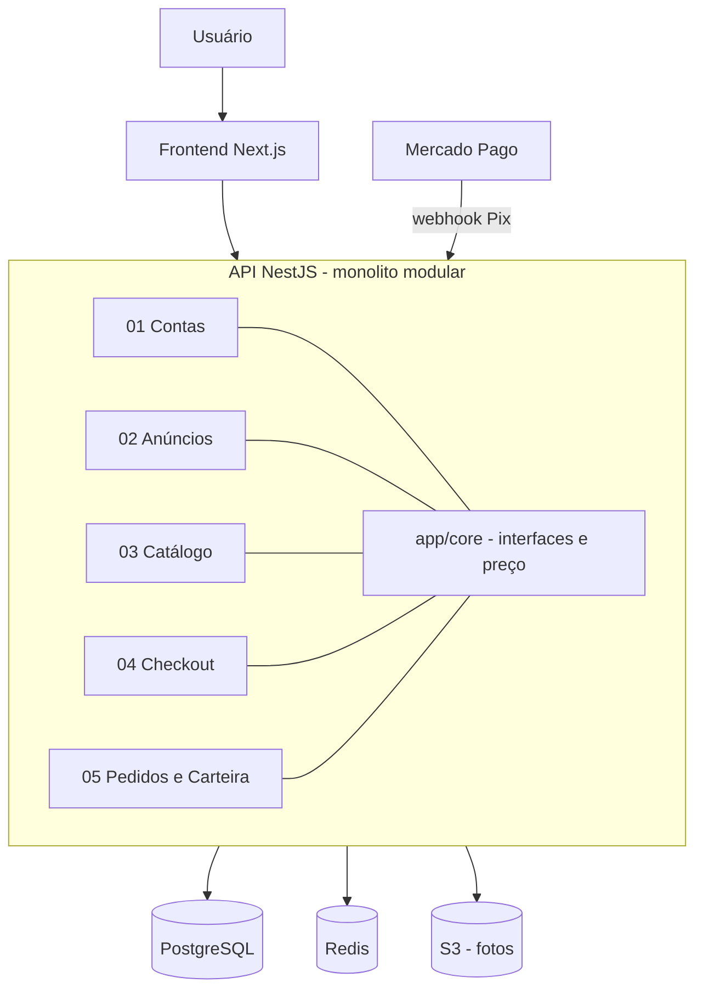
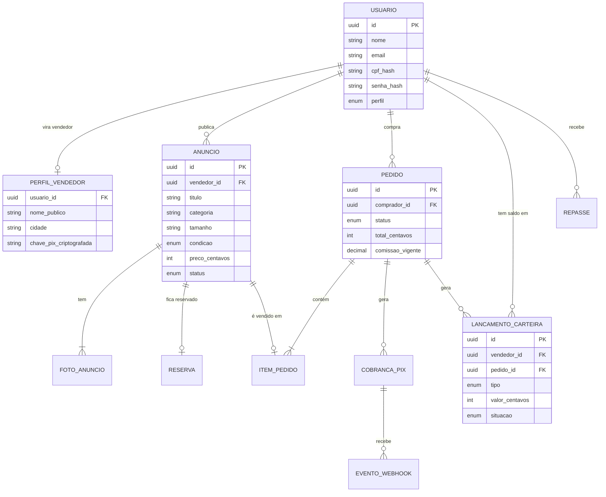

<div align="center">

# Desa Pego

**Brechó online comunitário: qualquer pessoa anuncia as peças paradas no armário, vê quanto vai receber pela venda e o comprador paga com Pix.**


[](https://github.com/mariaclarapma/Desa-Pego/actions/workflows/ci.yml)


[Requisitos](REQUISITOS.md) · [Arquitetura](docs/ARQUITETURA.md) · [Issues](https://github.com/mariaclarapma/Desa-Pego/issues) · [Quadro do projeto](https://github.com/users/mariaclarapma/projects/2) · [Como contribuir](CONTRIBUTING.md)

</div>

---

> **Projeto em andamento.** O planejamento, a arquitetura e a esteira de CI já estão prontos; os módulos estão sendo desenvolvidos agora. Acompanhe o progresso pelas [issues](https://github.com/mariaclarapma/Desa-Pego/issues) e pelo [quadro do projeto](https://github.com/users/mariaclarapma/projects/2).

## Sobre o projeto

O Desa Pego conecta quem quer desapegar de roupas e calçados com quem procura moda acessível e circular. A plataforma cuida da parte chata de uma venda entre pessoas: reserva da peça, cobrança via Pix, divisão do valor e repasse ao vendedor.

- **Para quem vende:** cadastra a peça com fotos, usa o simulador para ver o valor líquido que vai receber e acompanha o saldo na carteira.
- **Para quem compra:** busca e filtra a vitrine, reserva a peça no checkout e paga com Pix.
- **Para quem administra:** define comissão, taxas e frete, registra os repasses e modera anúncios.

Uma mesma conta pode comprar e vender. Ela passa a vender ao cadastrar uma chave Pix.

Está sendo desenvolvido como projeto acadêmico do curso de Ciência da Computação do **CEUB**, por um grupo de cinco pessoas, com um fluxo de trabalho parecido com o de uma equipe de produto: requisitos com critérios de aceitação, issues, branches por requisito, Pull Requests com revisão obrigatória e CI.

## Status do projeto

| Etapa | Situação |
| --- | --- |
| Levantamento dos 15 requisitos do MVP com critérios de aceitação | Concluído |
| Documento de arquitetura com 8 decisões registradas (ADRs) | Concluído |
| Organização do repositório: issues, labels, quadro, templates e revisão em rodízio | Concluído |
| CI com lint, testes (PostgreSQL e Redis) e detecção de segredos | Concluído |
| Desenvolvimento dos 5 módulos (backend e frontend) | Em andamento |
| Testes de integração entre os módulos e homologação | A fazer |
| Segurança (CORS, API key, CSP, limite por IP), testes E2E com Cypress e auditoria de acessibilidade | Concluído |
| Deploy (Render + Supabase): [desapego.onrender.com](https://desapego.onrender.com) | Concluído |

## Como funciona uma venda

```mermaid
flowchart LR
    A[Vendedor anuncia a peça] --> B[Simulador mostra o valor líquido]
    B --> C[Peça aparece na vitrine]
    C --> D[Comprador inicia o checkout]
    D --> E[Peça fica reservada por 15 min]
    E --> F[Pagamento via Pix]
    F --> G[Webhook confirma o pagamento]
    G --> H[Vendedor envia a peça]
    H --> I[Comprador confirma o recebimento]
    I --> J[Saldo liberado na carteira]
```



## Funcionalidades do MVP

O MVP tem **15 requisitos** divididos em **5 módulos independentes**, um para cada integrante. Os módulos só conversam entre si pelas interfaces de `app/core`.

| Módulo | Requisitos | Responsável |
| --- | --- | --- |
| **01** · Contas e Perfil do Vendedor | [#1](../../issues/1) Cadastro e Login · [#2](../../issues/2) Perfil com Chave Pix · [#3](../../issues/3) Testes | Clarice Nunes |
| **02** · Anúncios e Simulador de Ganho | [#4](../../issues/4) Criar e Gerenciar Anúncio · [#5](../../issues/5) Simulador e Preço Sugerido · [#6](../../issues/6) Testes | Lívia Morais |
| **03** · Catálogo e Detalhes da Peça | [#7](../../issues/7) Vitrine com Busca e Filtros · [#8](../../issues/8) Detalhes da Peça · [#9](../../issues/9) Testes | Helena Furtado |
| **04** · Carrinho, Checkout e Pix | [#10](../../issues/10) Carrinho com Reserva · [#11](../../issues/11) Checkout com Pix · [#12](../../issues/12) Testes | Marina Almeida |
| **05** · Pedidos, Carteira e Administração | [#13](../../issues/13) Status do Pedido · [#14](../../issues/14) Carteira e Painel do Admin · [#15](../../issues/15) Testes | Maria Clara Pedrosa |

Alguns pontos que tornam o projeto interessante do ponto de vista técnico:

- **Peça única, sem venda duplicada:** a reserva usa atualização atômica no banco (`UPDATE ... WHERE status = 'disponivel'`) e expira sozinha por um job no Redis.
- **Webhook idempotente:** a confirmação do Pix tem assinatura validada e só muda o pedido uma vez, mesmo se o evento chegar repetido.
- **Carteira como livro-razão:** cada venda gera lançamentos imutáveis em centavos, e o saldo é a soma deles. Nada de saldo "editado à mão".
- **Mesmo cálculo no front e no back:** o simulador de ganho e o pedido usam a mesma função em `app/core/pricing`, então o valor que o vendedor vê é o valor que ele recebe.
- **Máquina de estados do pedido:** transições inválidas (ex.: marcar como entregue antes de pago) são rejeitadas no backend.

Os critérios de aceitação de cada requisito estão no [REQUISITOS.md](REQUISITOS.md).

## Tecnologias

| Camada | Tecnologia |
| --- | --- |
| Frontend | Next.js (React) com TypeScript, SSR/ISR |
| Backend | NestJS (Node.js 20) com TypeScript, monolito modular |
| Banco de dados | PostgreSQL com Prisma Migrate e busca full-text |
| Cache, reservas e filas | Redis + BullMQ |
| Fotos das peças | Amazon S3 (MinIO no ambiente local) |
| Pagamento | Pix via `PagamentoProvider` (Mercado Pago; `PixSimuladoProvider` em dev e testes) |
| Testes | Jest + Supertest |
| CI | GitHub Actions + gitleaks |
| Infraestrutura planejada | Docker, AWS ECS Fargate, Terraform, Cloudflare |

## Arquitetura

Monolito modular: uma única API, dividida em cinco módulos com fronteiras claras. Cada integrante é dona de um módulo e os testes mockam as interfaces de `app/core`, então ninguém fica travada esperando o código da outra.



As principais decisões, com o motivo de cada uma, estão registradas como ADRs no [Documento de Arquitetura](docs/ARQUITETURA.md#10-decisões-arquiteturais), por exemplo: monolito modular em vez de microsserviços, somente Pix no MVP, carteira como livro-razão e ECS Fargate em vez de Kubernetes.

## Modelo de dados



> Modelo inicial, baseado no documento de arquitetura. Ele será ajustado conforme os módulos forem implementados.

## Perfis de acesso

| Ação | Comprador | Vendedor | Admin |
| --- | :---: | :---: | :---: |
| Buscar peças, reservar e pagar com Pix | Sim | Sim | Não |
| Ver as próprias compras e confirmar recebimento | Sim | Sim | Não |
| Anunciar peças e usar o simulador de ganho | Não | Sim | Não |
| Ver carteira, extrato e vendas; marcar pedido como enviado | Não | Sim | Não |
| Definir comissão, taxa Pix, frete e tabela de preço sugerido | Não | Não | Sim |
| Registrar repasse ao vendedor e ocultar anúncios | Não | Não | Sim |

As permissões são validadas no backend, por perfil e por posse do recurso (ex.: só o vendedor do pedido marca o envio). O frontend apenas esconde opções.

## Segurança e LGPD

- Senhas com hash **Argon2id**, JWT de curta duração e refresh token em cookie httpOnly.
- CPF e chave Pix **criptografados por campo**; a chave Pix é exibida mascarada e o CPF nunca aparece no perfil público.
- Duplicidade de CPF verificada por hash, sem precisar descriptografar.
- Endereço do comprador visível apenas para o vendedor daquele pedido.
- Webhook do Pix com assinatura validada e idempotência pelo ID do evento.
- Rate limiting em cadastro, login, busca e checkout.
- Nenhum segredo no repositório: `.env` fora do Git (veja o [`.env.example`](.env.example)) e **gitleaks** rodando em toda a história do repositório na CI.

## Como rodar localmente

A primeira versão do código (seminário de Desenvolvimento Web do CEUB) roda sem Docker. Ela é um monorepo com npm
workspaces:

| Pasta | O que tem |
| --- | --- |
| `frontend/` | Next.js 15 (App Router), React 19, TypeScript e **Tailwind CSS v4**, com layout pensado primeiro para celular. Testes unitários com Vitest e E2E com **Cypress** (`frontend/cypress/`). |
| `backend/contas/` | Serviço de contas: Express + TypeScript + PostgreSQL. Cadastro, login, JWT e CRUD da conta. Porta 3002. |
| `backend/catalogo/` | API do catálogo: Express + TypeScript, com peças, reservas, pedidos e rotas de integração. Porta 3001. |
| `backend/pedidos/` | Módulo 05: pedidos (máquina de estados), carteira (livro-razão), repasses e painel da administração. Express + TypeScript + PostgreSQL. Porta 3003. |
| `backend/comum/` | Peças compartilhadas pelos serviços: CORS por lista, limite por IP, API key, leitura do JWT, conexão com o Postgres, divisão em centavos e categorias permitidas. |

### Instalar e rodar

Requer **Node.js 22.13 ou mais novo**.

```bash
npm install        # instala frontend e backend
npm run gerar-env  # cria o .env com JWT_SECRET e API_KEYS aleatórios (só na primeira vez)
npm run dev        # site em http://localhost:3000 · catálogo :3001 · contas :3002 · pedidos :3003
```

| Comando (na raiz) | O que faz |
| --- | --- |
| `npm test` | testes unitários e de API (Vitest + Supertest) do frontend e do backend |
| `npm run e2e` | testes E2E com Cypress: faz o build, sobe os serviços e roda tudo |
| `npm run e2e:abrir` | abre o Cypress interativo (rode `npm run build` antes) |
| `npm run cobertura` | cobertura combinada (Vitest + Cypress) com relatório em `coverage/index.html`; falha abaixo de 80% |
| `npm run lint` / `npm run typecheck` / `npm run build` | lint, checagem de tipos e build de produção |
| `npm run reset-db` | volta o catálogo ao estado inicial |
| `npm start` | modo produção (depois do `npm run build`): site, contas, catálogo e pedidos juntos, como na hospedagem |

### Variáveis de ambiente

Frontend e backend leem o mesmo arquivo: o **`.env` na raiz**, criado pelo `npm run gerar-env` a partir do
[`.env.example`](.env.example). O `.env` **nunca vai para o Git**. Na hospedagem, as variáveis ficam no painel do
Render.

| Variável | Para que serve | Padrão em desenvolvimento | Em produção |
| --- | --- | --- | --- |
| `JWT_SECRET` | assina os tokens de acesso (32+ caracteres) | gerado a cada início | **obrigatório** |
| `API_KEYS` | chaves aceitas no `X-API-Key` das rotas de integração (separadas por vírgula) | sem chave, a integração fica desligada | gerada pelo Render |
| `CORS_ORIGENS` | origens do frontend liberadas no CORS (separadas por vírgula) | `http://localhost:3000` | **obrigatório** |
| `DATABASE_URL` | PostgreSQL das contas e dos pedidos (Supabase; schemas `contas` e `pedidos`) | vazio = banco em memória | **obrigatório** |
| `ADMIN_MASTER_EMAIL`, `ADMIN_MASTER_PASSWORD` | conta da administradora master (Ludy), criada ou promovida ao iniciar | sem elas, não há master | no painel do Render |
| `LIMITE_CADASTROS_POR_HORA` | cadastros por hora por IP | `10` | `10` |
| `TRUST_PROXY` | proxies confiáveis para ler o IP real | `loopback` | `loopback, uniquelocal` |
| `PORTA_CONTAS`, `PORTA_CATALOGO`, `PORTA_PEDIDOS`, `CONTAS_API_URL`, `CATALOGO_API_URL`, `PEDIDOS_API_URL`, `COOKIE_PATH` | portas e endereços internos | já preenchidos | iguais |

### Testes

| Tipo | Ferramenta | Onde | O que cobre |
| --- | --- | --- | --- |
| Unitários e de API | Vitest + Supertest | `*.test.ts(x)` ao lado do código | regras de negócio, validação, segurança (CORS, API key, limite), CRUD da conta pela API |
| E2E | Cypress | `frontend/cypress/e2e/` | login, cadastro e logout; navegação (celular e desktop); CRUD da conta; compra (sacola, checkout, pedido, Pix); cabeçalhos de segurança |
| Acessibilidade | cypress-axe (axe-core) | dentro dos E2E | WCAG 2.1 A e AA em todas as páginas, nos temas claro, escuro e alto contraste |

Os E2E falham se o navegador registrar qualquer violação da CSP, então eles também validam a política de segurança.

**Cobertura:** a meta é **80% combinada**, com unitários (Vitest) e E2E (Cypress) num relatório só. O
`npm run cobertura`:
1. roda o Vitest do frontend e do backend com Istanbul;
2. faz um build separado do site com o código instrumentado (`babel-plugin-istanbul` depois do SWC; o mapa de
   origem leva a cobertura de volta para os `.tsx`);
3. roda o Cypress com o `@cypress/code-coverage`, que lê a cobertura do navegador e do servidor do Next;
4. junta tudo com o `nyc` em `coverage/index.html` e falha se linhas ou instruções ficarem abaixo de 80%
   (configuração em [`scripts/nyc-relatorio.json`](scripts/nyc-relatorio.json)).

Resultado atual: **85,2% das linhas e 83,4% das instruções** (frontend + backend), com 126 testes unitários e de
API e 22 testes E2E.

> No Windows, rodando de dentro do VS Code: o script de E2E remove a variável `ELECTRON_RUN_AS_NODE`, que o VS Code
> define e que impede o Cypress de abrir.

### Acessibilidade (WCAG 2.1 AA)

- **HTML semântico**: `header`, `nav` com `aria-label`, `main`, `footer`, títulos em ordem, `dialog` nativo no menu do
  celular e link "pular para o conteúdo".
- **Formulários**: todo campo tem `<label>` visível (o placeholder não serve de rótulo) e `autocomplete`. Erros aparecem
  ao lado do campo (`aria-invalid` e `aria-describedby`) e em `role="alert"`, e o foco vai para o primeiro campo errado.
- **Teclado**: foco visível em tudo; menu e painéis fecham com Esc e devolvem o foco; abas de entrar e cadastrar
  funcionam com as setas.
- **Leitor de tela**: botões só com ícone têm nome acessível; a sacola anuncia quantas peças tem; avisos dinâmicos
  usam `aria-live`.
- **Contraste e temas**: claro, escuro e alto contraste, conferidos pelo axe. Os textos decorativos (marcas d'água)
  ficam fora da regra de contraste, como o WCAG 1.4.3 permite.
- **Imagens**: `alt` descritivo nas fotos das peças e `alt=""` nas decorativas.
- **Extras**: barra de acessibilidade (tamanho da fonte, tema e VLibras) e layout testado em 375 px.

### Contas: autenticação e CRUD de usuários (Módulo 01, [#1](../../issues/1))

| Operação | Tela | Rota da API | Regras |
| --- | --- | --- | --- |
| **Create** | `/cadastro` | `POST /auth/cadastro` | nome e sobrenome, e-mail válido e único, senha com 8+ caracteres, letra e número; hash Argon2id |
| **Login / logout** | `/entrar`, botão **sair da conta** | `POST /auth/login`, `POST /auth/logout` | JWT de 15 min na memória + refresh token rotativo em cookie httpOnly; mensagem de erro genérica; 5 erros bloqueiam por 15 min |
| **Read** | `/conta` (rota privada) | `GET /auth/me` | só a conta dona do token; nunca devolve senha nem hash; sem sessão, volta para `/entrar` |
| **Update** | `/conta` → **editar dados** | `PATCH /auth/me` | o nome muda sem senha; trocar o e-mail pede a senha atual e não pode usar o e-mail de outra conta |
| **Update** | `/conta` → **alterar senha** | `PUT /auth/me/senha` | confere a senha atual; a nova precisa ser forte e diferente; encerra as sessões dos outros aparelhos |
| **Delete** | `/conta` → **excluir minha conta** | `DELETE /auth/me` | confirmação + senha; exclusão definitiva, todas as sessões encerradas e cookie apagado |

Roteiro rápido: crie uma conta em `/cadastro` → veja os dados em `/conta` → edite o nome → troque o e-mail (com a
senha) → troque a senha → saia e entre com a senha nova → exclua a conta.

Detalhes da API em [`backend/README.md`](backend/README.md) e da interface em [`frontend/README.md`](frontend/README.md).
Testes: `backend/contas/src/app.test.ts` (cadastro, login e sessão), `backend/contas/src/crud.test.ts` (as quatro
operações), `frontend/src/app/conta/crud.test.tsx` (telas da conta) e, de ponta a ponta,
`frontend/cypress/e2e/conta-crud.cy.ts` e `autenticacao.cy.ts`.

### API do catálogo e integração

| Rota | Quem usa | O que faz |
| --- | --- | --- |
| `GET /pecas`, `GET /pecas/:id` | site | vitrine e página da peça |
| `POST /pecas/:id/reservar` | site (sacola) | reserva por 15 min; o servidor decide numa fila, então duas pessoas não reservam a mesma peça |
| `POST /pecas/:id/liberar` | site (sacola) | desfaz a reserva |
| `POST /pedidos`, `GET /pedidos/:id` | site (checkout) | cria e consulta o pedido; preço, frete e total são calculados no servidor |
| `POST /integracao/pagamentos/:id/confirmar` | **parceiro, com `X-API-Key`** | o "webhook" do Pix: marca o pedido como pago e as peças como vendidas (idempotente) |
| `GET /integracao/pedidos?status=` | **parceiro, com `X-API-Key`** | exporta os pedidos, por exemplo para um sistema de gestão |

Pelo site, tudo fica sob `/api` (por exemplo, `https://desapego.onrender.com/api/integracao/pedidos`). O botão
"simular pagamento" chama a integração por uma server action do Next.js, então a API key nunca chega ao navegador.

```bash
curl -H "X-API-Key: <sua chave do .env>" http://localhost:3000/api/integracao/pedidos?status=pago
```

### Módulo 05: pedidos, carteira e administração ([#13](../../issues/13), [#14](../../issues/14), [#15](../../issues/15))

Os endpoints estão documentados em [`docs/openapi.yaml`](docs/openapi.yaml).

**Perfis.**
- Qualquer conta compra e vende.
- A **administradora master** (Ludy, perfil `ADMIN_MASTER`) é criada pela seed a partir de `ADMIN_MASTER_EMAIL` e
  `ADMIN_MASTER_PASSWORD`. Só existe uma (há um índice único no banco), e ela não pode ser excluída nem bloqueada.
  Só ela acessa o painel.

**Pedido.** Os status seguem uma máquina de estados:

| De | Para | Quem pode |
| --- | --- | --- |
| aguardando pagamento | pago | sistema (webhook do Pix, com API key) |
| aguardando pagamento | cancelado | compradora, administração ou sistema (Pix expirado) |
| pago | enviado | só a vendedora do pedido |
| pago | cancelado | só a administração (estorna o saldo pendente) |
| enviado | entregue (recebido) | só a compradora do pedido |

- Uma transição fora da tabela responde **409**.
- Quem não participa do pedido, ou tenta a ação da outra parte, recebe **403**.
- O endereço de entrega só aparece para a vendedora.

**Dinheiro.**
- Os valores ficam em centavos inteiros, e a comissão em pontos-base (1000 = 10,00%), também inteira.
- A comissão é arredondada só com inteiros (`backend/comum/dinheiro.ts`), e a vendedora fica com o resto. Então
  **comissão + vendedora = total**, sem diferença de centavo. O frete vai inteiro para a vendedora, que é quem envia.
- O percentual de comissão é **congelado no pedido**: mudar a comissão no painel vale só para os pedidos novos.

**Carteira (livro-razão).** Cada fato gera um lançamento que nunca é alterado:

| Fato | Efeito no saldo |
| --- | --- |
| pedido pago | o valor da vendedora entra como **pendente** |
| pedido recebido | o valor passa de pendente para **disponível** |
| pedido pago e depois cancelado | estorna o pendente |

- A vendedora solicita o saque. O pedido é recusado (**422**) se passar do disponível menos o que já está em saque.
- A administração faz o Pix manualmente e registra o pagamento, que debita o disponível.

**Categorias.**
- A lista é fixa: roupas femininas e masculinas, calçados, bolsas e acessórios (`backend/comum/categorias.ts`).
- O painel marca como irregular o anúncio fora dela. A administração pode ocultá-lo, e ele não pode voltar à vitrine.
- O Módulo 02 (anúncios) usa a mesma validação ao criar o anúncio.

**Painel (`/admin`).** Tem as seções visão geral, usuárias (busca, bloquear e desbloquear), anúncios (ocultar e
reexibir), pedidos (filtro por status), comissão e repasses. A tela só esconde as opções: o backend responde 403 a
quem não é a administradora master.

**Testes do Req. 015.**

| Arquivo | O que cobre |
| --- | --- |
| `backend/pedidos/src/pedidos.test.ts` | transições válidas e inválidas, 403 para quem não é dona do pedido, divisão com R$ 10,01 e R$ 33,33, liberação do saldo só depois do recebimento, repasse maior que o saldo, comissão nova sem afetar pedidos antigos, 403 no painel |
| `backend/comum/dinheiro.test.ts` | divisão exata para todos os valores de R$ 0,00 a R$ 100,00 em 8 comissões, e as categorias permitidas |
| `backend/catalogo/src/app.test.ts` | admin oculta anúncio; anúncio em categoria não permitida (ex.: eletrônicos) é recusado |
| `backend/contas/src/admin.test.ts` | seed da master, master protegida, bloqueio de contas, 403 no painel |
| `frontend/src/app/admin/page.test.tsx` e `frontend/cypress/e2e/admin.cy.ts` | tela do painel, acesso restrito e auditoria de acessibilidade |

```bash
npm test -w backend   # testes do backend, incluindo o Req. 015
npm run e2e           # E2E com o painel
```

**Ainda depende de outros módulos:**
- o checkout real (Módulo 04) chamar `POST /api/gestao/interno/pedidos` e o webhook chamar
  `/pagamento-confirmado`; até lá, o checkout de demonstração continua como estava;
- o CRUD de anúncios da vendedora (Módulo 02);
- a regra da chave Pix para anunciar (Módulo 01).

## Segurança da aplicação (o que está implementado)

| Camada | Como | Onde |
| --- | --- | --- |
| **Autenticação por token** | JWT HS256 de 15 min, guardado só na memória do navegador. Refresh token de 30 dias em cookie `httpOnly`, `Secure`, `SameSite=Strict`, com rotação; se um token já usado reaparece, todas as sessões da conta caem. As rotas `/auth/me*` passam pelo middleware `autenticado`. | `backend/contas/src/app.ts`, `tokens.ts` |
| **Senhas** | Argon2id; mensagens genéricas no login; reautenticação para trocar e-mail ou senha e para excluir a conta | `backend/contas/src/senhas.ts` |
| **API key** | `X-API-Key` nas rotas `/integracao/*`; chaves só em variáveis de ambiente (`API_KEYS`), comparadas em tempo constante; sem chave configurada, as rotas ficam desligadas | `backend/comum/seguranca.ts` |
| **CORS** | só as origens de `CORS_ORIGENS`, nunca `*`. Origem de fora recebe 403, o que também barra formulários de outros sites (CSRF) | `backend/comum/seguranca.ts` |
| **CSP e cabeçalhos** | Páginas: CSP (scripts só do próprio site e do VLibras; `frame-ancestors 'none'`; `object-src 'none'`), X-Frame-Options DENY, nosniff, Referrer-Policy, Permissions-Policy, COOP e HSTS em produção, sem `x-powered-by`. APIs: Helmet. | `frontend/next.config.ts`, `app.ts` dos serviços |
| **Limite de requisições (camada 7)** | por IP: login (5 erros bloqueiam 15 min), cadastro (10/h), escrita no catálogo (30/min) e leitura (300/min), com `Retry-After` | `backend/comum/seguranca.ts`, `backend/contas/src/limite.ts` |
| **Validação e sanitização** | Zod em todas as entradas (tamanho, formato, campos permitidos); ids só com `[a-zA-Z0-9_-]`; corpo limitado a 10 KB; o React escapa todo texto exibido (sem `dangerouslySetInnerHTML` com dado de usuário) | `validacao.ts`, `catalogo/src/app.ts` |
| **Regras no servidor** | preço, frete, total, reserva e pagamento são decididos pelo backend; as rotas genéricas de escrita do antigo json-server não existem mais | `backend/catalogo/src/app.ts` |
| **Segredos** | `.env` fora do Git; gitleaks na CI em todo o histórico | `.github/workflows/ci.yml` |

**Por que algumas coisas não foram feitas:**
- **Nonce na CSP:** a CSP usa `'unsafe-inline'` em scripts e estilos, porque o Next.js injeta trechos inline. Um
  nonce exigiria renderizar todas as páginas dinamicamente.
- **Redis:** o limite de requisições fica em memória, o que basta para uma instância só. Com mais instâncias, ele iria
  para o Redis, como prevê a arquitetura.

### WAF e firewall de camada 7 em produção

A aplicação já se defende sozinha: valida as entradas, limita requisições por IP e usa a CSP. Um **WAF**
(Web Application Firewall) fica **na frente** dela e barra ataques antes de chegarem ao servidor.

O Render já passa pela rede da Cloudflare, mas sem regras configuráveis. Para ter um WAF próprio, o caminho
recomendado (e grátis) é este:

1. **Domínio próprio na Cloudflare** (por exemplo, `desapego.com.br`) com o proxy ligado (nuvem laranja), apontando
   para o serviço do Render. Depois, adicione o domínio em `CORS_ORIGENS`.
2. **Regras gerenciadas** (Security → WAF → Managed rules): bloqueiam injeção de SQL, XSS, path traversal e outros
   ataques do OWASP Top 10. No plano grátis, vem o "Cloudflare Free Managed Ruleset".
3. **Limite por IP na borda** (Security → WAF → Rate limiting rules), por exemplo: `POST /api/auth/login` com mais de
   10 por minuto bloqueia o IP por 10 minutos. Essa regra soma com o limite que já existe na aplicação.
4. **Bots e DDoS**: Bot Fight Mode e a proteção DDoS de camada 7, que é automática.
5. **Regras próprias**: bloquear países ou ASNs de onde vêm ataques, desafiar (*challenge*) o acesso a
   `/api/integracao/*` fora da lista de IPs dos parceiros, e só aceitar HTTPS (SSL "Full (strict)").
6. **Origem fechada**: aceitar só tráfego vindo da Cloudflare (no Render, pelo cabeçalho `CF-Connecting-IP`), e então
   usar `TRUST_PROXY` com os IPs da Cloudflare para ler o IP real.

Na AWS, o equivalente é o **AWS WAF** com as *managed rule groups* (Core rule set, Known bad inputs, SQL database),
uma *rate-based rule* por IP, e o WAF associado ao CloudFront ou ao Application Load Balancer na frente do ECS
(previsto na arquitetura).

## Hospedagem (Render + Supabase, plano grátis)

| Peça | Onde | O que faz |
| --- | --- | --- |
| Site, serviço de contas e catálogo | **Render** (Web Service) | um único serviço roda os três, como no `npm run dev` ([`render.yaml`](render.yaml)) |
| Banco das contas | **Supabase** (PostgreSQL) | guarda contas e sessões; as tabelas ficam no schema `contas`, fora da API pública |

**1. Banco no Supabase**

1. Em [supabase.com](https://supabase.com), crie um projeto na região **East US (Ohio)**, a mesma do
   Render. Guarde a senha do banco.
2. Clique em **Connect** e copie a URL do **Session pooler** (porta 5432). O Render só fala IPv4, e a conexão
   direta do plano grátis é só IPv6. Troque `[YOUR-PASSWORD]` pela senha do banco.
3. Não precisa criar tabelas: o serviço de contas cria o schema `contas` sozinho no primeiro início.

**2. Site no Render**

1. Em [render.com](https://render.com), entre com o GitHub e escolha **New → Blueprint**. Selecione este repositório:
   o `render.yaml` já traz o build, o start, a região, o Node 22 e um `JWT_SECRET` gerado automaticamente.
2. Quando o Render pedir `DATABASE_URL`, cole a URL do Supabase. Ela fica só no painel do Render, nunca no Git.
3. Espere o deploy e abra a URL `https://desapego-xxxx.onrender.com`. Cada push no `main` publica de novo.

**Limites do plano grátis**

- O Render "dorme" depois de 15 minutos sem acesso. O primeiro acesso depois disso demora uns 50 segundos, então
  abra o site um pouco antes de apresentar.
- O Supabase pausa o projeto depois de 7 dias sem uso. Reative no painel; os dados continuam lá.
- O catálogo (json-server) volta ao estado inicial a cada reinício do Render. As **contas** ficam salvas no Supabase.

## O que estou aprendendo

- Transformar uma ideia em requisitos com critérios de aceitação testáveis e dividir o trabalho de forma justa entre cinco pessoas.
- Registrar decisões de arquitetura (ADRs) explicando o porquê de cada escolha, e não só o quê.
- Tratar concorrência em um caso real: duas pessoas tentando comprar a mesma peça ao mesmo tempo.
- Modelar dinheiro com segurança: valores em centavos, livro-razão imutável e webhooks idempotentes.
- Montar uma esteira de CI com banco e cache como serviços e detecção automática de segredos.
- Organizar um repositório de equipe com issues, quadro, templates, CODEOWNERS e revisão obrigatória de PRs.

## Próximos passos

Depois da primeira entrega, a arquitetura já prevê o encaixe de:

- cartão de crédito e boleto (nova implementação de `PagamentoProvider`);
- repasse automático e frete calculado com rastreio;
- login com Google e 2FA no painel do admin;
- avaliações, disputas, favoritos e notificações por e-mail;
- contador de impacto ambiental, passaporte da peça e outras ideias de economia circular.

## Autoras

| | |
| --- | --- |
| **Clarice Nunes** | [@claricenunes](https://github.com/claricenunes) |
| **Lívia Morais** | [@livmoorais](https://github.com/livmoorais) |
| **Helena Furtado** | [@helenafurtadoo](https://github.com/helenafurtadoo) |
| **Marina Almeida** | [@Marinasz05](https://github.com/Marinasz05) |
| **Maria Clara Pedrosa** | [@mariaclarapma](https://github.com/mariaclarapma) |

Projeto acadêmico desenvolvido no curso de Ciência da Computação do **CEUB – Centro Universitário de Brasília**.
